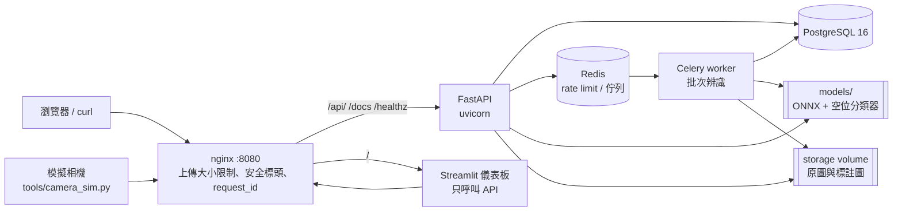
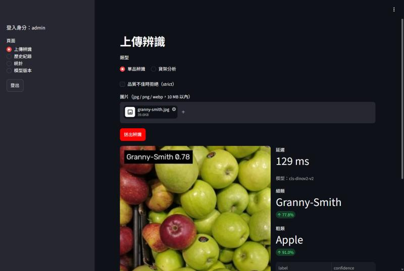
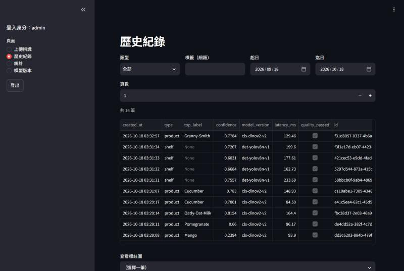
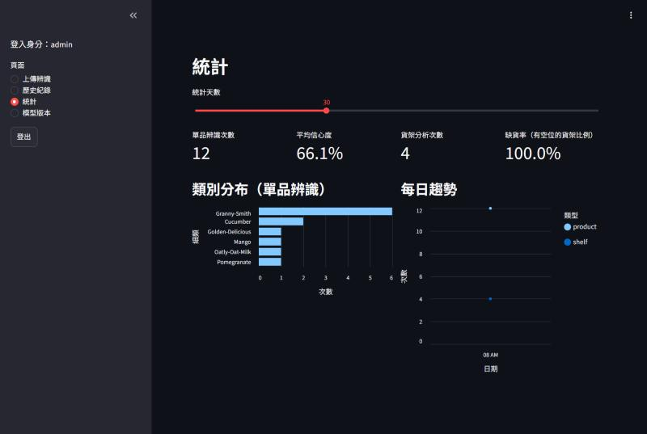
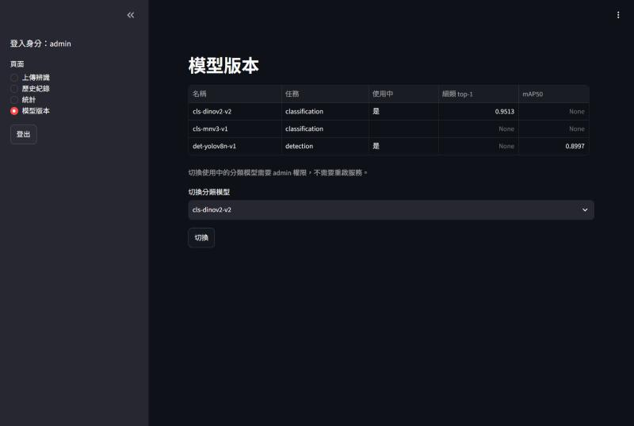

# RetailVision：零售商品影像辨識服務

作品集專案。用公開資料集模擬超市情境，做三件事：

1. **單品辨識**：拍一個商品，回答它是什麼（細類 81 種 + 粗類 43 種）。
2. **貨架分析**：拍一排貨架，算出商品數量、缺貨空位、陳列密度。
3. **新品登錄與以圖搜圖**：新商品不用重新訓練，上傳幾張參考圖就能辨識。

> 進度：Phase 1（模型）、Phase 2（API 與資料庫）、Phase 3（部署、CI、儀表板）完成。


## 架構



- 對外只開 nginx 一個埠，其他服務都不對 host 開埠。兩個 docker 網路：backend（internal，不能連外網：db、redis、api、worker、nginx）
  與 frontend（nginx、dashboard、camera）。儀表板與模擬相機連不到 API，只能經過 nginx。
- API 只信任 nginx 固定 IP 帶來的 `X-Forwarded-For`（uvicorn `--forwarded-allow-ips`），nginx 再用實際連線 IP 覆寫這個 header，
  偽造的 header 繞不過依 IP 的限流（實測：經 nginx、或從內部網路直連 API，每次換 header 都在第 61 次被擋）。
- API 和 worker 用同一個映像檔（`docker/Dockerfile.api`，不含 PyTorch，822 MB），推論只用 ONNX Runtime。
- 使用中的模型版本以資料庫為準：切換後 API 和 worker 的下一個請求就改用新模型，不需重啟。

## 快速開始（docker compose）

需要 Docker 與下列模型檔（放在 `models/`）。**權重不在 repo 裡**：模型是用研究用途授權的資料集訓練的，
不公開散布，請依「重現步驟」自行訓練產生。

| 檔案 | 用途 | 產生方式 |
|---|---|---|
| `cls-dinov2-v2.onnx` / `.json` | 單品分類與 embedding（上線版本） | `training.train_metric` + `training.export_onnx` |
| `cls-mnv3-v1.onnx` / `.json` | 單品分類 v1（對照，可切換） | `training.train_classifier` + `training.export_onnx` |
| `det-yolov8n-v1.onnx` / `.json` | 貨架商品偵測 | `training.train_detector` + `training.export_onnx` |
| `gap_classifier.joblib` / `.json` | 缺貨空位分類器 | `training.fit_gap_classifier` |

```bash
cp .env.example .env
# 填入 POSTGRES_PASSWORD、JWT_SECRET、ADMIN_PASSWORD（範例檔刻意留空，沒填 compose 會直接報錯）
# 產生隨機值：python -c "import secrets; print(secrets.token_urlsafe(32))"
docker compose up -d --build
curl http://localhost:8080/healthz
```

範例值（`replace-with...`、`change-me...`）會被拒絕：JWT_SECRET 用範例值時 API 無法啟動，admin 密碼用範例值時不會建立帳號。

API 容器啟動時會自動執行 `alembic upgrade head`、登錄 `models/` 裡的模型版本，並依 `.env` 的
`ADMIN_USERNAME` / `ADMIN_PASSWORD` 建立 admin（已存在就略過，不會覆寫密碼）。
沒有放模型檔時服務仍會全部啟動，`/healthz` 回 503 並指出缺哪個模型（實測）。
容器的 healthcheck 用 `/livez`（process 活著就好），`/healthz` 是 readiness，兩者分開，
否則沒有權重時 API 會被標成 unhealthy，依賴它的 nginx 也起不來。

- 儀表板：http://localhost:8080/
- OpenAPI 文件：http://localhost:8080/docs
- 模擬相機：先建一般使用者 `docker compose exec api python -m app.cli create-user camera --role user`
  並在 `.env` 設定 `CAMERA_USERNAME` / `CAMERA_PASSWORD`（不會 fallback 到 admin），
  再 `docker compose --profile camera up -d camera`，把圖片放進 `camera_inbox/`，
  約 1 到 3 秒後出現在歷史紀錄，檔案移到 `camera_inbox/processed/`（失敗的移到 `failed/` 並附錯誤訊息）。
  只處理資料夾直接底下的一般圖片檔；符號連結與特殊檔案會被移到 `failed/`，不會讀取它指向的內容。

### curl 範例

```bash
BASE=http://localhost:8080/api/v1
TOKEN=$(curl -s -X POST $BASE/auth/token -d "username=admin&password=<你的密碼>" | jq -r .access_token)
AUTH="Authorization: Bearer $TOKEN"

# 單品辨識
curl -s -X POST $BASE/recognitions/product -H "$AUTH" -F "file=@apple.jpg"

# 貨架分析，下載標註圖
ID=$(curl -s -X POST $BASE/recognitions/shelf -H "$AUTH" -F "file=@shelf.jpg" | jq -r .id)
curl -s $BASE/recognitions/$ID/annotated -H "$AUTH" -o shelf_annotated.jpg

# 批次辨識（Celery），查詢進度
JOB=$(curl -s -X POST $BASE/recognitions/batch -H "$AUTH" -F "files=@a.jpg" -F "files=@b.jpg" | jq -r .job_id)
curl -s $BASE/jobs/$JOB -H "$AUTH"

# 新品登錄（1 到 5 張參考圖）與以圖搜圖
curl -s -X POST $BASE/catalog/products -H "$AUTH" -F "name=新口味燕麥奶" -F "files=@ref1.jpg" -F "files=@ref2.jpg"
curl -s -X POST $BASE/search/similar -H "$AUTH" -F "file=@query.jpg"

# 歷史、統計、切換模型（admin）
curl -s "$BASE/recognitions?type=product&page=1&size=20" -H "$AUTH"
curl -s "$BASE/stats/summary?days=30" -H "$AUTH"
curl -s -X PUT $BASE/models/active -H "$AUTH" -H "Content-Type: application/json" -d '{"name": "cls-mnv3-v1"}'
```

## 模型比較

| 任務 | 模型 | 主要指標（測試集） | CPU 延遲 p95 | 狀態 |
|---|---|---|---|---|
| 單品分類 | HSV + HOG + SVM | 細類 31.3% | 約 8 ms | baseline |
| 單品分類 | v1 MobileNetV3-Large | 細類 85.7%、以圖搜圖 52.8% | 7.7 ms | 對照，可切換 |
| 單品分類 | **v2 DINOv2-small + SupCon** | **細類 95.1%、以圖搜圖 95.3%** | 55.8 ms | 上線 |
| 貨架偵測 | **YOLOv8n（ONNX）** | **mAP50 0.900** | 212 ms（含空位） | 上線 |
| 缺貨空位 | v1 規則 | 召回 26.6% / 精確 61.0% | | 對照 |
| 缺貨空位 | **v2 梯度提升樹** | 召回 56.4% / 精確 38.7%（未達 70%） | | 上線 |

延遲是模型本身（含前處理）；API 端到端延遲見下方。細節在各段落與 `models/metrics.json`。

## Demo 截圖

| 上傳辨識 | 歷史紀錄 |
|---|---|
|  |  |
| **統計（類別分布、每日趨勢、缺貨率）** | **模型版本與切換** |
|  |  |

截圖與上方標註圖中的商品照片分別來自 Grocery Store Dataset 與 SKU-110K 測試集，只作非商用展示。

## Phase 1 結果

指標全部來自 `models/metrics.json`，由 `training/evaluate.py` 用**匯出後的 ONNX 模型**計算（也就是上線時實際使用的檔案）。

### 單品分類（Grocery Store 測試集 2,485 張）

| 模型 | 細類 top-1 | 細類 top-5 | 粗類 top-1 | CPU 延遲 p95 |
|---|---|---|---|---|
| HSV 直方圖 + HOG + SVM（baseline） | 31.3% | 無 | 48.0% | 約 8 ms（只算 SVM） |
| v1：MobileNetV3-Large 雙頭（ONNX） | 85.7% | 98.2% | 90.5% | 7.7 ms |
| **v2：DINOv2-small + SupCon 雙頭（ONNX，上線版本）** | **95.1%** | **99.8%** | **96.7%** | 55.8 ms |
| 門檻（驗收 1.4） | 75% | 95% | 85% | |

- 延遲機器：RTX 3050 Laptop 4 GB 的筆電，ONNX Runtime CPU 執行，單張圖片，含前處理。
- 驗收 1.6：v1、v2 的 ONNX 與 PyTorch 在 296 張 val 圖上 logits 最大誤差都 < 1e-3，top-1 一致率 100%（`tests/unit/test_onnx_parity.py`）。
- v1 是第一版模型，因為以圖搜圖（1.7）沒達標而改成 v2，保留下來做對照（見下方以圖搜圖段落）。

### 最常混淆的類別（驗收 1.9，v2 模型）

混淆矩陣：`models/confusion_fine.png`、`models/confusion_coarse.png`

| 排名 | 類別組 | 次數 | 可能原因 |
|---|---|---|---|
| 1 | Satsumas 被判成 Orange | 20（反方向只有 1） | 都是橘色、圓形、表皮紋理相近，主要差別在大小，但照片沒有尺度參考；v1 時兩個方向都會錯，v2 剩下單向 |
| 2 | Golden-Delicious 與 Granny-Smith | 13（9 對 4） | 黃綠色調在賣場暖色燈光下很接近；v1 時有 20 次 |
| 3 | Royal-Gala 被判成 Pink-Lady | 10（單向） | 兩者都是紅黃漸層的表皮，差別在顏色比例和斑點，堆成一堆時很難分辨 |

共同點：容易混淆的都是**同一粗類裡的不同品種**（柑橘、蘋果），所以粗類準確率（96.7%）高於細類（95.1%）。這也是做雙頭輸出的理由：細類不確定時，API 至少能回報可信的粗類。

### 以圖搜圖（驗收 1.7）

Gallery 是**每類 1 張官方白底標準圖、1 個向量**（嚴格定義），查詢是 2,485 張店內實拍測試圖。

| 模型 | test top-1 | test top-5 |
|---|---|---|
| v1：MobileNetV3（只用分類損失訓練） | 52.8% | 83.2% |
| **v2：DINOv2-small + SupCon（上線版本）** | **95.3%** | **99.9%** |
| 門檻 | 70% | |

**新商品泛化**（另外訓練一個實驗模型，固定 seed 挑出的 20 個細類完全不參與訓練；gallery 仍然是 81 類各 1 張標準圖）：

| 類別 | test top-1 | test top-5 | 張數 |
|---|---|---|---|
| 訓練時看過的 61 類 | 95.6% | 99.9% | 1,823 |
| **訓練時沒看過的 20 類** | **47.0%** | **92.7%** | 662 |

v2 能達到 95% 有一部分原因是**訓練時看過這些商品的標準圖**。對完全沒看過的新商品，第一名的準確率只有大約一半，但正確答案有 93% 會出現在前 5 名。所以新品登錄的 API 應該回傳前 k 名讓人確認，不要直接採用第一名。
v1 的失敗分析、A 和 B 兩種方案的比較，以及選擇的理由，都記在 [docs/experiments/retrieval_1_7.md](docs/experiments/retrieval_1_7.md)。

### 影像品質檢查

`vision/quality.py` 用 Laplacian 變異數判斷模糊。門檻 30 是用訓練集 2,640 張校正的：原圖 99.8% 通過，`GaussianBlur(9x9, sigma=2)` 之後最高只有 26.5。
常見的門檻 100 是給高解析度文件照用的，蔬果表面平滑，用 100 會誤判六成原圖是模糊的。

### 貨架偵測（驗收 1.5，SKU-110K 完整測試集 2,936 張）

| 模型 | mAP50 | mAP50-95 | CPU 延遲 p95（偵測 + 貨架分析） |
|---|---|---|---|
| YOLOv8n，PyTorch 權重 | **0.903** | 0.546 | 無 |
| YOLOv8n，ONNX（上線版本） | **0.900** | 0.544 | 212 ms（含空位分類器） |
| 門檻 | 0.75 | | |

- 訓練：3,000 張固定子集，640 輸入，batch 8，AMP，60 epochs（RTX 3050 4 GB，約 1.7 小時）。
- `max_det=1000`：SKU-110K 一張圖可能有 700 個商品，預設上限 300 會讓 mAP 被低估。
- **抓到的錯誤**：一開始把 `max_det` 傳給 `cv2.dnn.NMSBoxes` 的 `top_k`。OpenCV 的 `top_k` 是在 NMS **之前**只保留前 k 個候選框，密集貨架的候選框有好幾千個，一張圖會少偵測 10% 以上的商品。`tests/unit/test_detector_parity.py` 比對 Ultralytics 用同一個 ONNX 檔的推論結果時發現這個問題，修正後兩邊的框數量與位置完全一致。

### 缺貨空位（驗收 1.8，未達標）

評估集：15 張人工標註貨架圖（SKU-110K test）、94 個空位；IoU >= 0.3、一對一配對。

| 方法 | 召回率 | 精確率 |
|---|---|---|
| v1：空隙寬度 + 紋理規則 | 26.6% | 61.0% |
| **v2：候選（空隙 + 偵測框）+ 梯度提升樹** | **56.4%** | **38.7%** |
| 門檻 | 70% | |

v2 用另外 40 張調參集（SKU-110K val、236 個空位）訓練，門檻在調參集的交叉驗證上預先選好，評估集只跑一次。
召回率比 v1 提高一倍，但仍未達 70%：交叉驗證的召回率剛好壓在 70%，換到評估集就掉下來；
偵測器把空格誤框成商品、候選框形狀和人工標註對不上、深色商品和空背板外觀相近，是主要的限制。
CNN 特徵、多種形狀的候選都試過，沒有幫助。完整紀錄見 [docs/experiments/gaps_1_8.md](docs/experiments/gaps_1_8.md)。這項是 L3，依規格記錄原因，不調整門檻。

貨架分析完整流程（偵測 + 空位分類器）的 CPU 延遲 p95 為 212 ms。

偵測模型只框出有商品的地方，空位要從框之間的空隙推算（`vision/shelf.py`），先依框的高度分層：

- **v2（上線版本）**：候選有兩種，一種是層內框與框之間的空隙（0.4 個商品寬以上），另一種是**偵測框本身**（偵測器會把暗色的空格誤框成商品）。對每個候選算出和同層商品比較的外觀特徵（亮度、飽和度、邊緣密度與其變異、寬度、偵測信心、是否在貨架邊緣），用梯度提升樹判斷，最後用 NMS 去掉重複。被判成空位的偵測框不算進商品數量。
- **v1（對照）**：只看空隙寬度，再做**紋理驗證**，也就是比較空隙和同層商品的邊緣密度（Canny 加積分影像）。偵測器漏掉的商品還是有包裝的邊緣和文字，真正缺貨的地方通常只看得到背板。

空位分類器的模型檔（`.joblib`）不 commit；載入前會比對 `.json` 裡記錄的 SHA-256，而且只從模型資料夾載入（pickle 反序列化會執行程式碼，絕不載入使用者提供的檔案）。

人工標註流程與避免高估召回率的設計見 `training/annotate_gaps.py`。

## Phase 2：RESTful API

FastAPI + PostgreSQL 16 + Redis + Celery。基底路徑 `/api/v1`，OpenAPI 文件在 `/docs`。
除了 `/auth/token` 和 `/healthz`，所有端點都要 `Authorization: Bearer <token>`。

| 方法 | 路徑 | 說明 |
|---|---|---|
| POST | `/auth/token` | 帳號密碼換 JWT（30 分鐘） |
| POST | `/recognitions/product` | 單品辨識（細類、粗類、top-k、catalog 配對） |
| POST | `/recognitions/shelf` | 貨架分析（商品框、空位、缺貨比例、陳列密度） |
| POST | `/recognitions/batch` | 批次辨識，回 202 + job_id，由 Celery worker 處理 |
| GET | `/jobs/{id}` | 批次進度、失敗的項目 |
| GET | `/recognitions` | 歷史查詢：type、label、from、to、page、size |
| GET | `/recognitions/{id}`、`/recognitions/{id}/annotated` | 單筆結果、標註圖 |
| POST / GET / DELETE | `/catalog/products` | 新品登錄（1 到 5 張參考圖，不需重新訓練）、列表、刪除（admin） |
| POST | `/search/similar` | 以圖搜圖，回傳前 k 名 |
| GET / PUT | `/models`、`/models/active` | 模型版本與指標、切換使用中模型（admin，不需重啟） |
| GET | `/stats/summary` | 類別數量、平均信心度、缺貨率、每日趨勢 |
| GET | `/healthz` | 資料庫、Redis、模型狀態 |

### 延遲（驗收 2.12，CPU）

| 端點 | p50 | p95 | 門檻 |
|---|---|---|---|
| 單品辨識（DINOv2-small） | 88.9 ms | **104.7 ms** | 300 ms |
| 貨架分析（YOLOv8n + 空位分類器） | 347.6 ms | **454.7 ms** | 1.5 秒 |
| 單品辨識，docker compose（經 nginx） | 94.4 ms | **139.2 ms** | 300 ms |
| 貨架分析，docker compose（經 nginx） | 335.4 ms | **504.7 ms** | 1.5 秒 |

機器：AMD Ryzen 7 4800H（16 個邏輯 CPU）、Windows 11、ONNX Runtime CPU；docker 列是同一台機器上 WSL2 的 Linux 容器。
量的是 client 端看到的完整延遲（上傳、驗證、推論、存檔、寫資料庫），依序送出不並行（`tools/bench_latency.py`），
壓測時暫時調高 rate limit。結果在 `models/metrics.json` 的 `api_latency`、`api_latency_docker`。

### 安全設計

- 密碼 argon2id；JWT 只接受 HS256、必須有 exp；角色以資料庫為準，不信任 token 裡的 role。
- 上傳驗證：10 MB 上限（讀取時就截斷）、副檔名白名單、magic bytes 判斷實際格式、**解碼前先讀檔頭檢查像素數**（防 decompression bomb）、實際解碼。
- 檔名一律由伺服器產生（UUID），不使用使用者提供的檔名；讀檔時再確認路徑沒有跑出 storage 資料夾。
- 一般使用者只看得到自己的紀錄，別人的紀錄回 404；所有 SQL 走 ORM 或參數化查詢。
- 統一錯誤格式 `{"error": {"code", "message", "request_id"}}`，500 錯誤不回傳內部訊息；JSON 結構化日誌，每個請求都有 request_id。
- Redis 計數的 rate limit（預設每分鐘 60 次）；登入端點依 IP 限制。
- 空位分類器（pickle 格式）載入前比對 SHA-256，只從模型資料夾載入。

### 不用 docker 的本機開發

```bash
cp .env.example .env            # 填密碼與 JWT_SECRET，DATABASE_URL 換成同一個密碼
# docker-compose.dev.yml 讓 db / redis 綁到 127.0.0.1（正式部署不載入）
docker compose -f docker-compose.yml -f docker-compose.dev.yml up -d db redis
alembic upgrade head
python -m app.cli seed-models
python -m app.cli create-user admin --role admin
uvicorn app.main:create_app --factory --port 8000
celery -A app.worker worker --pool=solo   # Windows 只能用 solo pool
```
## Phase 3：部署與 CI

- **CI**（`.github/workflows/ci.yml`）：ruff（版本釘選）、mypy、pytest（PostgreSQL / Redis service container，
  覆蓋率至少 80%）、建置映像檔並檢查不含 PyTorch 與大小 < 1.5 GB。CI 沒有 GPU、不下載資料集，
  需要權重或資料集的測試會自動 skip。
- **映像檔版本**：`docker/constraints.txt` 鎖定和訓練環境相同的套件版本（例如空位分類器是 scikit-learn 1.9.1 的 joblib 檔，版本不同可能載入失敗）。
- **日誌**：API、uvicorn 都輸出 JSON；request_id 由 nginx 產生並往下傳，錯誤回應的 `request_id` 可以直接對到日誌。
- **反向代理**：nginx 依端點設定上傳上限（一般 12 MB、批次 101 MB、新品登錄 52 MB），覆寫 `X-Forwarded-For`
  為實際連線 IP，rate limit 才不會被偽造的 header 繞過。

## 重現步驟

```bash
python -m venv .venv
.venv/Scripts/python -m pip install torch==2.14.1+cu126 torchvision==0.29.1+cu126 --index-url https://download.pytorch.org/whl/cu126
.venv/Scripts/python -m pip install -e ".[train,dev]"

python training/data/download_grocery.py
python training/data/download_sku110k.py        # 約 12.2 GB，多連線續傳
python training/data/make_splits.py             # 切分檔已 commit，重跑結果相同

python -m training.train_classical
python -m training.train_classifier                 # v1（cls-mnv3-v1）
python -m training.train_metric --arch dinov2s --name classifier_dino_metric   # v2
python -m training.train_detector
python -m training.export_onnx                      # v1 分類 + 偵測
python -m training.export_onnx --task classifier --cls-ckpt checkpoints/classifier_dino_metric/best.pt --cls-version cls-dinov2-v2
python -m training.fit_gap_classifier               # 空位分類器（只用調參集標註）
python -m training.evaluate
pytest
```

## 資料集出處與授權

本專案只做非商用展示，不重新散布任何原始資料；資料集由腳本從官方來源下載，不包含在 repo 裡。

- **Grocery Store Dataset**：M. Klasson, C. Zhang, H. Kjellström. *A Hierarchical Grocery Store Image Dataset with Visual and Semantic Labels.* WACV 2019. https://github.com/marcusklasson/GroceryStoreDataset
  - 使用官方 train / val / test 切分。粗類實際有 43 個（論文寫 42，以資料中的 `classes.csv` 為準）。
- **SKU-110K**：E. Goldman et al. *Precise Detection in Densely Packed Scenes.* CVPR 2019. https://github.com/eg4000/SKU110K_CVPR19
  - 訓練用固定 seed 抽樣的 3,000 張子集，評估用完整官方測試集 2,936 張。

## 已知限制

- 儀表板經過 nginx 呼叫 API，對 API 來說所有儀表板使用者的連線 IP 都是儀表板容器；
  登入端點依 IP 限流，所以同時很多人從儀表板登入失敗時會共用同一份額度（登入後的請求依帳號限流，不受影響）。

- 以圖搜圖對訓練時沒看過的新商品，第一名準確率約 47.0%（前 5 名約 92.7%），應該回傳前 k 名讓人確認。
- 缺貨空位判斷依賴偵測結果：偵測器表現差的畫面（例如吊掛式小包裝、透視角度很大的棧板堆疊），分層和空位都會不準；表面平滑、沒有圖案的包裝也可能被誤判成空位。
- 細類只有 81 種，都是瑞典超市的商品；換到其他國家的商品需要重新訓練或登錄參考圖。
- 只偵測「正面看得到的缺貨空位」。前排有商品、後排已經空了（商品被往前推）的「庫存偏低」，正面照片看不到深度，無法偵測。

## 延伸方向

- 庫存偏低偵測：需要從上方或斜角拍攝、深度相機，或層板重量感測，才看得到後排是否還有商品。
